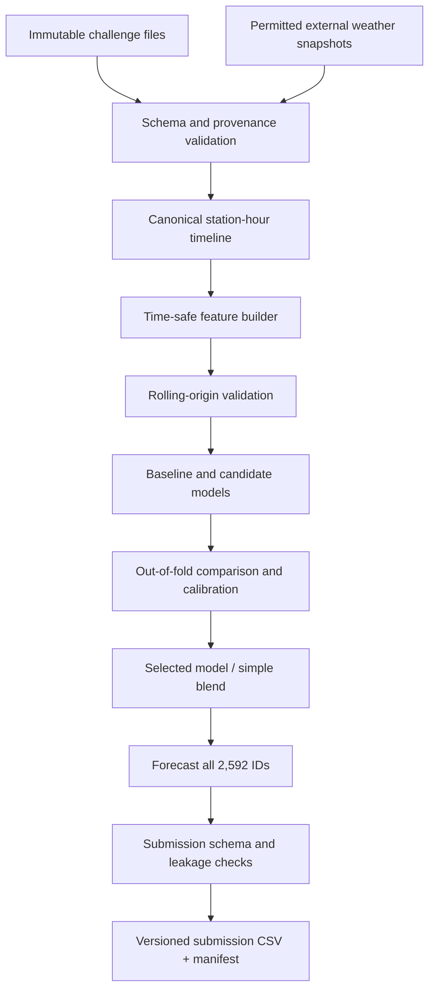

# Initial Forecasting Architecture

## Guiding principle

Build a small, leakage-safe forecasting system where new data sources and model complexity earn their place through matched rolling-origin validation. Current recommendation is a **baseline-first candidate architecture**, not a frozen final model.

## Information clocks

Every forecast example must explicitly distinguish:

1. **PM history cutoff:** latest timestamp/observation allowed into PM2.5-derived features.
2. **Weather forecast issue time:** latest time at which a weather forecast run could have been available.
3. **Target interval:** start and end time of the PM2.5 hour being predicted.

These clocks need not be equal. Near the final deadline, PM history could be several days old while weather can be forecast from a run issued shortly before the submission.

## Logical pipeline



## Proposed Python package boundaries

```text
src/mumbai_pm25/
├── __init__.py
├── paths.py                 # repository-root and configured paths
├── schemas.py               # required columns and dtypes
├── ingest.py                # raw file loading, no mutation
├── audit.py                 # data quality and provenance checks
├── time_alignment.py        # timezone conversion and hour-start/end semantics
├── timeline.py              # reindex per station to hourly grid
├── availability.py          # PM cutoff and weather-run availability logic
├── features/
│   ├── __init__.py
│   ├── calendar.py
│   ├── pm_history.py
│   ├── weather.py
│   ├── spatial.py
│   └── year_over_year.py
├── baselines.py             # last value, means, medians, diurnal profile, EWM
├── models/
│   ├── __init__.py
│   ├── lightgbm_ratio.py
│   └── ensemble.py
├── validation.py            # fold generation and scoring
├── forecasting.py           # prediction orchestration
└── submission.py             # build/validate CSV and manifest
```

Keep feature code pure where possible: input frame + explicit cutoff/config -> output features. Avoid hidden global timestamps.

## Initial model ladder

- **M0 Last value:** last eligible observation per station; naïve control.
- **M1 Recent level:** recent 24/72/168/336-hour mean, median and exponentially weighted mean.
- **M2 Diurnal profile:** station-specific hour-of-day profile from the latest 7 days; compare same-hour mean/median and hour-of-week variants. This is the current primary baseline candidate.
- **M3 Seasonal extension:** M2 plus calendar variables and previous-year same-hour feature (only if validated).
- **M4 LightGBM ratio model:** predict a log/ratio adjustment to a recent station level; current Claude report found `ratio_doy` more competitive than raw/sqrt variants in some folds, but evidence must be reproduced on full-target RMSE.
- **M5 Weather-enhanced model:** M2/M4 plus forecast-vintage variables; experiment only after terms/permissions and leakage-safe issue-time backtesting.
- **M6 Blend:** simple weighted blend of the best independently validated candidates. Current 50:50 M4/M2 is a provisional candidate, not a final accepted model.

Do not begin with deep networks or stacking. Reconsider only if a compact model has stable, repeatable residual structure that additional complexity can exploit.

## Forecast generation

For each station and test target hour:
- Build PM-derived features from the permitted PM history cutoff only.
- Build weather features from the selected forecast vintage available by weather issue time only.
- Make direct multi-horizon predictions or explicitly designed recursive predictions; never fill future lags with hidden target values.
- Use a transparent station-level fallback if a model feature is missing.
- Predict all rows, even if some are not scored.

## Data layout

- `data/raw/challenge/`: challenge files; immutable.
- `data/external/weather/`: downloaded forecasts and metadata; do not assume permission to commit raw external data.
- `data/processed/`: generated hourly grids/features; ignored by Git unless a small, explicitly approved reproducibility fixture.
- `artifacts/submissions/`: generated CSVs and manifests; ignored by default.

## Non-goals for the first iteration

- Deep neural sequence models.
- Broad static GIS ingestion.
- Blind concatenation of all AdditionalHistory tables.
- Tuning against a single public score.
- Target retrieval or leakage-based approaches.
