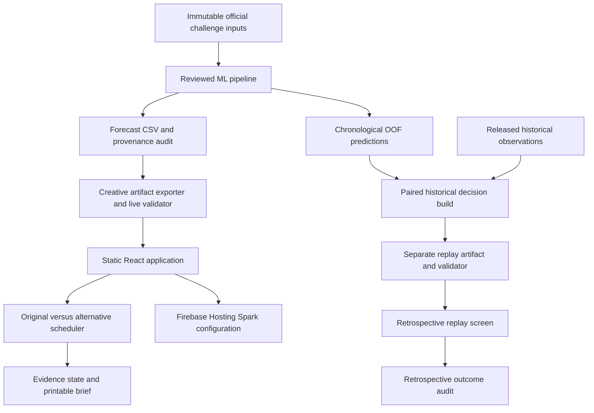

# AirWindow 2.0 - Architecture

The live forecast path contains predictions and metadata, with no subsequent actual targets. Historical actuals enter only the separate retrospective build/replay path, after forecast-based selection. The frontend does not train or refit the ML model. Deterministic exported evidence conditions on station, duration and lead; current calibration status is unavailable and permits abstention. The application uses bundled static artifacts, with no live external API required.

Firebase deployment is prepared, not completed, until an authorised Spark project and public-link verification are recorded. The Colab-compatible notebook verifies the historical evidence; it is not a live application dependency.
